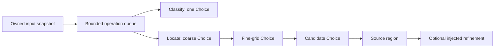

# Architecture and lifecycle

The public factory composes a DecisionPort and a Sharp-backed RasterPort. Processes orchestrate classify/locate; features contain pure Choice interpretation, grid geometry and prompt construction; entities define validated public contracts; infrastructure owns provider HTTP and image processing. No application runtime, game-state schema or workspace import is required.

One deadline covers the whole operation, including queue time. AbortSignal passes through every boundary; guards after awaits reject late results. Physical Sharp/provider work retains its slot until its promise settles. Timers/listeners are cleared in finally. There is no import-time worker, automatic retry, persistent image cache, database or background polling loop.

Transport validates complete question/answer correspondence, probabilities, identity and byte limits. Errors omit credentials, provider bodies and raw user media. Raw images exist only for the active operation unless an explicit caller-owned diagnostic wrapper records requests. Scores are not mixed across Choice distributions or interpreted as pixel/pose confidence.

Image handling normalizes EXIF orientation, validates bounded decode, crops in source pixels and prepares PNG presentations with recorded aspect-ratio/padding transforms. Labels map to exact canonical rectangles. Original and clean crops remain available alongside grid overlays. Final candidate pixels are source crops enlarged with integer nearest-neighbor scale.

Extraction differences from the gaming service: the public result is an area; multiple objects are allowed with one selected; no session/epoch/database/process host remains; the caller owns freshness of supplied bytes; generic image operations have an explicit45s library timeout instead of borrowing the gaming background8s budget. Stable ties use supplied class/grid order. Prompt wording and compact grid labels are documented source changes and require new quality evidence; old game-map results do not qualify this library.

ESLint catches common promise/race/interval errors and architectural checks reject private imports/cycles. These checks cannot prove native memory safety; tests additionally exercise cancellation, queue overload, late completion, input mutation and repeated lifecycle disposal.
