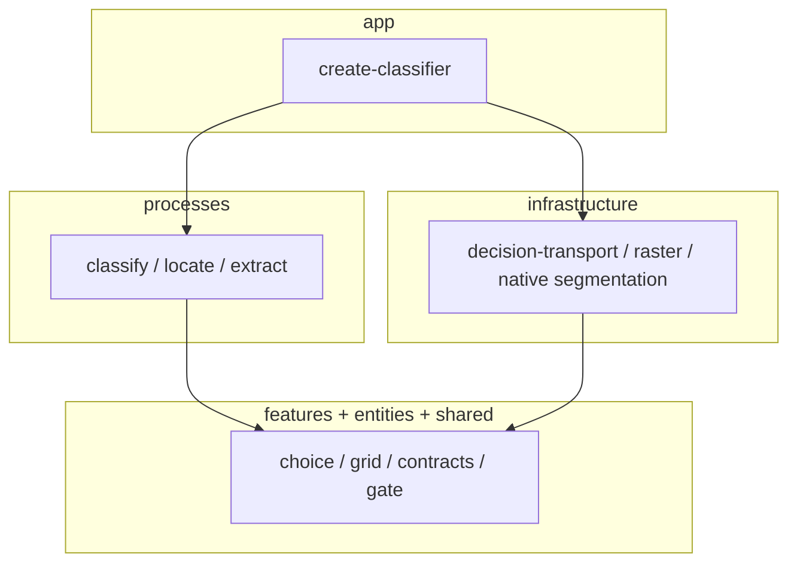
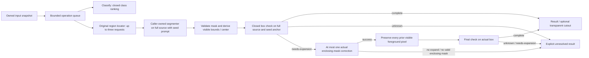

# Architecture and lifecycle

Russian guide with layer map, SOLID notes and current paths: [architecture.ru.md](architecture.ru.md). Development onboarding: [development.ru.md](development.ru.md).

Closed `classify` and injected `DecisionPort`/adapter transport are supported integration paths. Region `locate`, whole-object location, extraction, `RefinementPort`, caller-owned segmentation and box-check composition, `ObjectProposalPort`, and explicit native segmentation factories are experimental and unqualified; they are labeled `@experimental` on the public API. No spatial or extraction strategy is promoted; evidence under `docs/evidence/**` remains historical.

The public factory composes the caller-supplied `DecisionPort` and a Sharp-backed `RasterPort`. The library exposes four package entries (`.`, `./openrouter`, `./openai-compatible`, `./segmentation`); the CLI is a separate bin, not a fifth library export. The library does not select a model, provider or endpoint; applications either inject an existing port or explicitly build one with a supported adapter. **Import layers:** `app` composes `processes` and `infrastructure`; `processes` depend on `features`, `entities`, and `shared` port contracts only (no direct `processes` → `infrastructure` imports); `infrastructure` implements ports and may use `features`/`entities`/`shared`. Runtime calls reach HTTP, raster, and native work through injected port instances wired in `app`. Processes orchestrate classify/locate; features contain pure Choice interpretation, grid geometry and prompt construction; entities define validated public contracts. Benchmark runners live under `benchmarks/v02/`, `benchmarks/v03/`, and the repo root as well as helpers in `benchmarks/experiments/`; not all runners are under `experiments/`. No application runtime, game-state schema or workspace import is required.

The primary 0.2 object path preserves the original region locator. Its selected seed prompts an explicitly configured segmenter on the full oriented source image; actual mask pixels determine bounds, center and the optional cutout. A generic closed containment checker receives the full source with the mask-derived box and original seed anchor. It uses the injected decision port and a presentation port; the process allows at most one actual enclosing-mask correction and a final check. The segmenter can implement optional `expand`; corrected foreground must strictly contain the old visible foreground and grow the real box within the hard ROI. The process rejects unresolved checks without publishing a partial cutout. Its absolute deadline, cancellation and byte ownership cover every stage. No additional extent search or model-generated coordinates are used. `locate({ mode: 'whole-object' })` and `extract` use the same mask-derived geometry when a segmenter is configured. Boundary-interval location and `ObjectProposalPort` remain optional legacy strategies with their own request flows.

Extraction composes the selected locator with a caller-owned `SegmentationPort` and a `CutoutRasterPort`; processes import neither Sharp nor native inference. Explicitly created native adapters own their workers and queues, while the caller supplies and manages their optional runtime packages and local model assets. No weights are selected, installed or downloaded by the library. [Operation and ownership details](v02-usage.md) are explicit; no experimental text-image profile is publicly qualified yet.

Runtime orchestration (same primary extract semantics as below):

One deadline covers the whole operation, including queue time. AbortSignal passes through every boundary; guards after awaits reject late results. Physical Sharp/provider work retains its slot until its promise settles. Timers/listeners are cleared in finally. There is no import-time worker, automatic retry, persistent image cache, database or background polling loop.

The box renderer preserves the full source canvas. The injected raster `imageState` then prepares the whole rendered image for the transport, preserving aspect ratio with explicit scale/padding metadata and prepared sides between 280 and 1568 pixels. This never crops to the selected box and never changes the mask's source-space coordinates. Public-adapter regressions exercise both 64×48 and 1920×1080 inputs; DecisionPort-only fixtures do not exercise transport size validation.

Transport validates complete question/answer correspondence, probabilities, identity and byte limits. Errors omit credentials, provider bodies and raw user media. Raw images exist only for the active operation unless an explicit caller-owned diagnostic wrapper records requests. Scores are not mixed across Choice distributions or interpreted as pixel/pose confidence.

Image handling normalizes EXIF orientation, validates bounded decode, crops in source pixels and prepares PNG presentations with recorded aspect-ratio/padding transforms. Labels map to exact canonical rectangles. Original and clean crops remain available alongside grid overlays. Final candidate pixels are source crops enlarged with integer nearest-neighbor scale.

Extraction differences from the gaming service: the public result is an area; multiple objects are allowed with one selected; no session/epoch/database/process host remains; the caller owns freshness of supplied bytes; generic image operations have an explicit45s library timeout instead of borrowing the gaming background8s budget. Stable ties use supplied class/grid order. Prompt wording and compact grid labels are documented source changes and require new quality evidence; old game-map results do not qualify this library.

ESLint catches common promise/race/interval errors and architectural checks reject private imports/cycles. These checks cannot prove native memory safety; tests additionally exercise cancellation, queue overload, late completion, input mutation and repeated lifecycle disposal.

Knip checks the dynamically started native-worker entry. Its dependency allowlist contains only `onnxruntime-node`: Knip 5 flags referenced optional peers, while this package intentionally loads it only inside the explicit MobileSAM worker. The installed-archive check proves that core and segmentation entries import and their declarations compile without ONNX; requesting MobileSAM then fails explicitly. Other dependency/export checks remain enabled.

## Model and provider independence

`createOpenAICompatibleVision` accepts a trusted direct chat-completions endpoint, model ID, optional key/custom headers, and the same bounded transport policies. `createOpenRouterVision` adds explicit OpenRouter-only routing around that transport. Neither requires a native classifier endpoint. The core knows only `DecisionPort`; a non-OpenAI-compatible SDK can implement that port without changing geometry or lifecycle.

Ordinary language models receive images/text, closed option descriptions and a JSON answer schema. They return ranked IDs and independent categorical presence evidence. These are validated against the exact supplied questions/options; no ranks are converted to fake probabilities. The optional legacy native integration retains probability-valued answers for compatibility and historical benchmarking. A malformed/refused/truncated answer remains an error; it is never silently retried through another backend.

`createOpenRouterDecisions` is one optional adapter for a caller-chosen native model/provider. Luna Decisions appears in examples and benchmark recipes; it is not a library default. The adapter shares bounded snapshots/HTTP cleanup with the optional Jev wrapper and strips internal rank-count hints from the typed wire request. Native probability checks remain separate from ordinary chat ranking. Jev-specific quantization is never silently applied to another model. Results from one route do not imply that a stronger model will improve every task.
