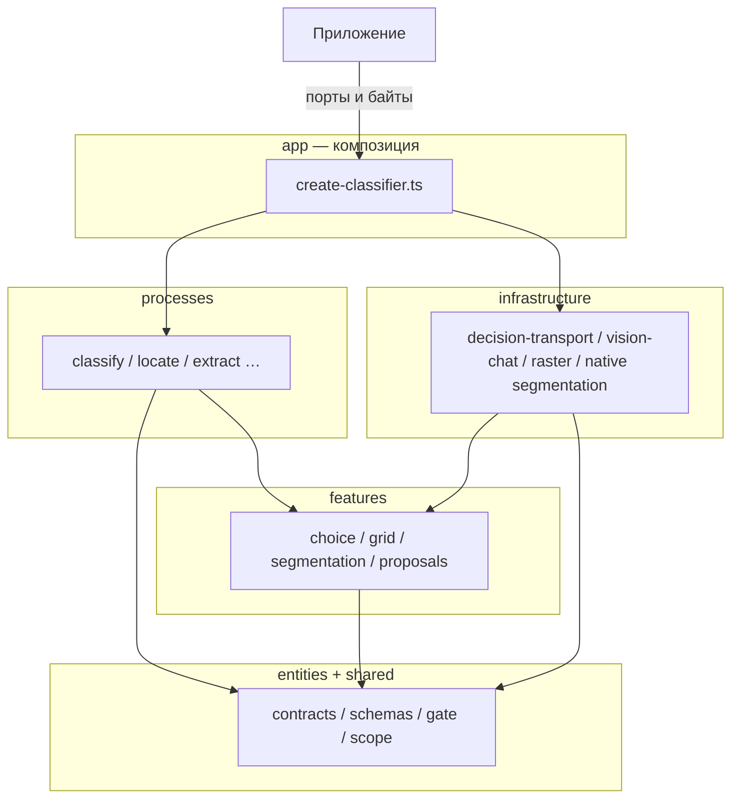
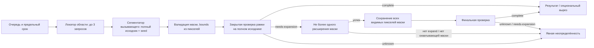

# Архитектура Zorya Classifier

Описание фактической структуры репозитория на ветке рефакторинга. Краткий обзор жизненного цикла на английском: [architecture.md](architecture.md). Инварианты для участников разработки и агентов: [AGENTS.md](../AGENTS.md).

## Назначение

Zorya Classifier — MIT-библиотека для Node.js 22.12+. **Поддерживается** закрытая классификация текста и изображений: приложение передаёт явно настроенный `DecisionPort` или собирает адаптер самостоятельно. Библиотека не выбирает модель, провайдера или конечную точку API.

**Экспериментальные и не квалифицированные** сценарии (в API помечены `@experimental`):

- сеточный `locate`, режим «целый объект» (`whole-object`), `RefinementPort`;
- `extract` с сегментатором на стороне вызывающего, проверка рамки и связанная композиция;
- `ObjectProposalPort` и явные нативные фабрики сегментации;
- профиль `representation: { type: 'experimental-text', … }` — отклонён (`UNSUPPORTED`), пока профиль не пройдёт независимый отбор.

Исследовательский код в `benchmarks/experiments/` и текстовые эксперименты без частей изображения **не входят** в дистрибутив npm. Отдельные скрипты в каталогах `benchmarks/v02/`, `benchmarks/v03/` и в корне `benchmarks/`: они используют вспомогательные модули из `experiments/`, но не сводятся к одной папке. Метрики в `docs/evidence/**` исторические; универсальное качество или «продвижение» стратегии из них не следует.

## Публичная поверхность пакета

Ровно **четыре** точки экспорта библиотеки в `package.json`: `.`, `./openrouter`, `./openai-compatible`, `./segmentation` (исходники: `index.ts`, `openrouter.ts`, `openai-compatible.ts`, `segmentation.ts` в `src/`). Исполняемый CLI (`zorya-classifier`, `cli.ts` → `dist/cli.js`, маршрутизация в `app/cli-route.ts`) — отдельная команда `bin`, **не** пятая точка входа библиотеки.

## Слои и пути

Правило зависимостей проверяет `npm run boundaries`: слои `entities` и `shared` не импортируют `infrastructure`; процессы не импортируют адаптеры напрямую — только контракты портов.

| Слой             | Роль                                             | Примеры путей                                                                                                                                                                            |
| ---------------- | ------------------------------------------------ | ---------------------------------------------------------------------------------------------------------------------------------------------------------------------------------------- |
| `app`            | Сборка классификатора, CLI, конфигурация         | `create-classifier.ts`, `classifier-contracts.ts`, `classifier-config.ts`, `classifier-runtime.ts`, `classifier-spatial.ts`, `classifier-representation.ts`, `cli-route.ts` в `src/app/` |
| `processes`      | Оркестрация операций                             | `classify.ts`, `locate.ts`, `extract.ts`, `extract-from-region.ts`, `whole-object.ts`, `proposal-location.ts`, `boundary-state.ts` в `src/processes/`                                    |
| `features`       | Чистая логика: Choice, сетка, промпты, маски     | `choice.ts`, `uniform-grid.ts`, `choice-beam-layout.ts`, `prompts.ts`, `src/features/segmentation/*`, `src/features/proposals/*`                                                         |
| `entities`       | Контракты, Zod, геометрия                        | `contracts.ts`, `classification.ts`, `decision.ts`, `geometry.ts`, `image.ts`, `localization.ts`, `validation.ts`, `segmentation-metadata.ts` в `src/entities/`                          |
| `infrastructure` | Реализации портов: HTTP, растр, фоновые процессы | `decision-transport/*`, `vision-chat/*`, `openrouter.ts`, `raster.ts`, `segmentation/mobile-sam/*`, `segmentation/grabcut/*` в `src/infrastructure/`                                     |
| `shared`         | Утилиты без слоя `infrastructure`                | `gate.ts`, `scope.ts`, `input-budget.ts`, `choice-mass.ts` в `src/shared/`                                                                                                               |

**Порт** — контракт (интерфейс и схемы), через который процесс вызывает внешнюю работу. **Кто владеет ресурсом:** вызывающее приложение **настраивает** `DecisionPort` (у порта **нет** контракта `dispose`); при завершении работы вызывающий вызывает `dispose()` классификатора и сам освобождает переданные `SegmentationPort` / `ObjectProposalPort`. Фабрика `createClassifier` владеет очередью операций и встроенным `RasterPort` на базе Sharp, переданным в процессы. Явно созданный нативный адаптер **владеет** своим дочерним процессом и закрывает его при `dispose` адаптера. Пакеты среды выполнения (ONNX и т. п.) и файлы моделей — **предварительные условия вызывающего**; библиотека их не скачивает и не освобождает автоматически.

## Диаграмма зависимостей импортов

Схема отражает **направление импортов**, а не порядок сетевых вызовов во время операции. Слой `app` собирает процессы и адаптеры; процессы опираются на нижние слои и контракты портов; слой `infrastructure` реализует порты и **не** импортируется из процессов. Во время выполнения работа идёт только через **внедрённые** экземпляры портов.

Прямого ребра «processes → infrastructure» в коде нет.

## Поток операции extract (`v0.2`)

Сначала локатор области находит подсказку `seed` на полном ориентированном исходном изображении. Сегментатор вызывающего получает **полное** изображение и `seed`; границы, центр и вырез считаются **только** по действительным пикселям маски. Закрытая проверка рамки на полном исходнике возвращает `complete`, `needs-expansion` или `unknown`:

- **`complete`** — можно сформировать результат (опциональный прозрачный вырез).
- **`needs-expansion`** — не более **одного** расширения охватывающей маски и **одной** финальной проверки; если финальная проверка снова **`complete`**, результат допустим.
- **`unknown`** — неразрешённая проверка, отсутствие поддержки расширения, нет действительной охватывающей маски или провал финальной проверки; **второго** расширения нет. Координаты от модели и «растянутая» рамка не используются.

## Ответственность по путям

| Задача                                     | Путь                                                                                                      |
| ------------------------------------------ | --------------------------------------------------------------------------------------------------------- |
| Фабрика, очередь, освобождение (`dispose`) | `src/app/create-classifier.ts`, `classifier-runtime.ts`                                                   |
| Пространственная сборка, проверка рамки    | `src/app/classifier-spatial.ts`                                                                           |
| Классификация                              | `src/processes/classify.ts`                                                                               |
| Трёхстадийный locate                       | `src/processes/locate.ts`                                                                                 |
| Извлечение                                 | `src/processes/extract-from-region.ts`, `extract.ts`                                                      |
| Валидация маски, правила проверки рамки    | `src/features/segmentation/validation.ts`, `source-mask.ts`, `region-result.ts`, `box-check.ts`           |
| HTTP-транспорт решений                     | `src/infrastructure/decision-transport/*`, `vision-chat/*`                                                |
| MobileSAM / GrabCut                        | `src/infrastructure/segmentation/mobile-sam/*`, `src/infrastructure/segmentation/grabcut/*`               |
| Исследования (вне дистрибутива npm)        | `benchmarks/experiments/create-research-classifier.ts`, `text-representation.ts`, `boundary-view.ts`      |
| Журналы / учётные данные                   | `benchmarks/runtime-source-files.ts`, `benchmarks/v03/integrity-receipts.ts`, `benchmarks/credentials.ts` |

## SOLID без лишних сервисов

Композиция отделена от оркестрации и от ввода-вывода: новый провайдер добавляется адаптером `DecisionPort`, геометрия и процессы не переписываются под каждый SDK. Процессы зависят от **малых** портов, а не от монолита. Отдельный сетевой микросервис классификации в репозитории не предусмотрен — изоляция модулей нужна для тестов, секретов и жизненного цикла.

## Состояние, байты и завершение работы

1. **Владение входом:** байты изображения и маски валидируются и фиксируются **до первого** `await`; последующая мутация буфера вызывающего не должна менять результат.
2. **Один абсолютный предельный срок** на операцию, включая ожидание в очереди; `AbortSignal` проходит через все границы.
3. **Ограниченная очередь:** при переполнении — `CAPACITY`.
4. **Слоты:** после отмены или тайм-аута результат операции не принимается, но слот удерживается, пока не завершится физическая работа (Sharp, HTTP, дочерний процесс, созданный адаптером). Это не обещание мгновенного возврата по календарному времени.
5. **`dispose()`** классификатора отменяет ожидающие и активные операции и дожидается завершения своих операций; общий `SegmentationPort` / `ObjectProposalPort` вызывающий освобождает сам.
6. **Нативные адаптеры:** только явный вызов фабрики; закреплённые байты через один дескриптор; без автоматической загрузки весов.

## Координаты исходника и маски

Обрезка, масштабирование и вписывание с сохранением пропорций и полями должны применяться **согласованно**: чистый слой, наложение и вырез строятся в одной системе координат исходника; панель с полями нельзя отображать на исходнике как растянутый прямоугольник. Для проверки рамки сначала рендерится полный холст исходника, затем внедрённый `RasterPort.imageState` готовит вид для транспорта (стороны 280–1568, сохранение пропорций и исходных координат маски). Регрессии публичных адаптеров проверяют и малые, и большие входы; заглушка `DecisionPort` не заменяет проверку подготовки транспорта.

## Пространственный контракт `v0.2`

Основной `extract`: локатор → сегментатор на полном ориентированном исходнике → границы, центр и вырез только из действительных пикселей маски → закрытая проверка (`complete` / `needs-expansion` / `unknown`) с ветвлением выше. Нет координат от модели, поиска по охвату и «растянутой» рамки при неразрешённом исходе. Верная рамка не доказывает идеальную сегментацию по каждому пикселю.

**Запросы порта решений:** внутри одного `extract` с `locate` — до 3 (locate) + 2 (проверки); отдельный сценарий «`classify` + `extract`» — до 6 запросов решений суммарно (см. [README.ru.md](README.ru.md)).

## Ранги, оценки Native Choice, пространственный луч, Noul

- Финальный выбор класса — **один** закрытый ID; лишние альтернативы для одной метки не требуются.
- Пространственные стадии луча — **четыре** упорядоченных кандидата; один финальный ID **не** равен четырём кандидатам луча.
- Обычный маршрут `vision-chat`: только ранг, без выдуманных `probabilities`; ранг **не** означает вероятность.
- Native Choice (Decisions API): сохраняются **исходные** оценки провайдера; при равенстве — **исходный порядок** входных классов; **без** автоматической нормализации. Любая интервальная квантовка требует явной аннотации адаптера и соответствующего теста на массу, отличную от единицы.
- **Noul** — **отдельное** двоичное решение о **наличии цели** (target-presence), не смешивается с выбором максимума по классам.
- Оценка качества у `ObjectProposalPort` — **некалиброванная** диагностика, может быть вне [0, 1]; **не** вероятность, **не** основание для семантического выбора и **не** отправляется модели как доказательство качества.

## Связанные документы

- [Разработка](development.ru.md) — установка, тесты, секреты.
- [v02-usage.md](v02-usage.md) — extract, CLI, сегментатор.
- [Эталонные прогоны](benchmarks.md) — платные CLI каталога `benchmarks` (не офлайн-каталог `npm test`).
- [План рефакторинга](refactoring-plan.ru.md) — измеренные контрольные точки платформ.
